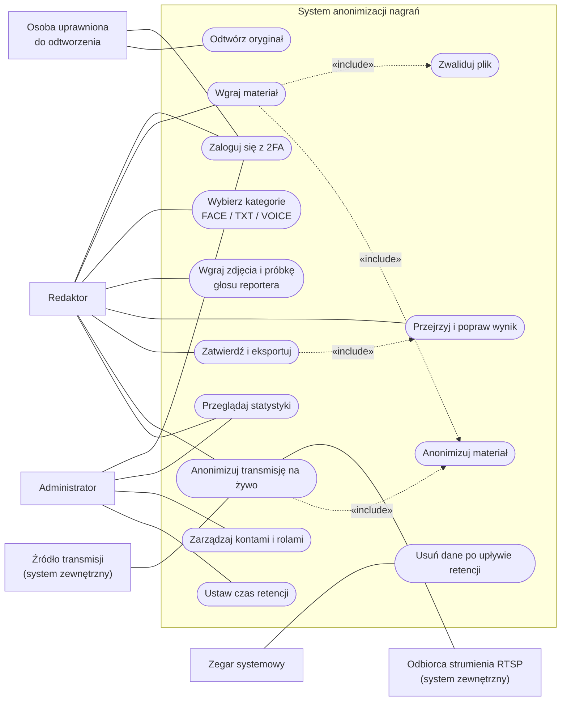
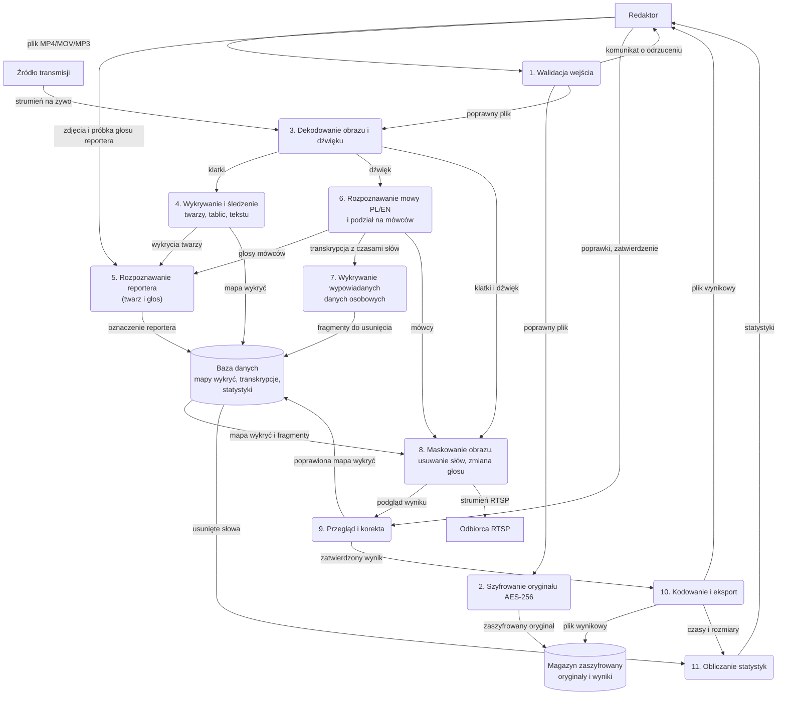
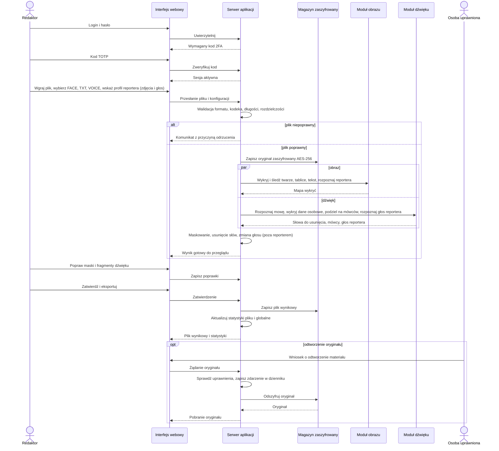
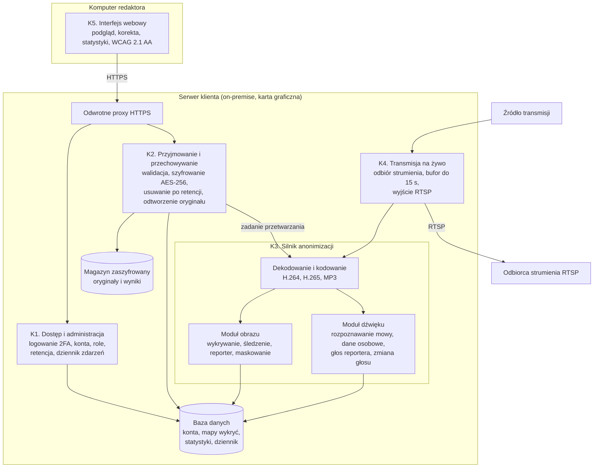

# Dokumentacja inżynierii wymagań

**System automatycznej anonimizacji materiałów wideo i audio dla ReportersWatch Sp. z o.o.**

| | |
|---|---|
| Przedmiot | Inżynieria Oprogramowania, AGH WIEiT, Teleinformatyka, 2026/27 |
| Klient | ReportersWatch Sp. z o.o., Karol Wiśniewski (Kierownik Działu Produkcji Wideo) |
| Zespół | Joanna Żupnik, Marcel Kuźma, Arkadiusz Baran |
| Prowadzący | Andrzej Matiolański |
| Wersja dokumentu | 0.1 (robocza) |

## Spis treści

1. [Wstęp](#1-wstęp)
2. [Członkowie zespołu](#2-członkowie-zespołu)
3. [Pytania do klienta i uzyskane odpowiedzi](#3-pytania-do-klienta-i-uzyskane-odpowiedzi)
4. [Słownik pojęć](#4-słownik-pojęć)
5. [Wymagania użytkownika](#5-wymagania-użytkownika)
6. [Wymagania systemowe](#6-wymagania-systemowe)
7. [Ustalony format danych](#7-ustalony-format-danych)
8. [Model systemu](#8-model-systemu)
9. [Diagram sekwencji UML](#9-diagram-sekwencji-uml)
10. [Projekt architektury systemu](#10-projekt-architektury-systemu)
11. [Kryteria akceptacji](#11-kryteria-akceptacji)
12. [Ryzyka projektowe](#12-ryzyka-projektowe)
13. [Ewolucja systemu](#13-ewolucja-systemu)
14. [Sugerowany język i technologie implementacji](#14-sugerowany-język-i-technologie-implementacji)

---

## 1. Wstęp

### 1.1. Cel dokumentu

Dokument opisuje wymagania wobec systemu automatycznej anonimizacji nagrań zamówionego przez firmę ReportersWatch Sp. z o.o. Stanowi podstawę do planowania prac zespołu, projektu architektury, implementacji oraz testów akceptacyjnych. Struktura dokumentu odpowiada typowym elementom dokumentacji wymagań opisanym przez Sommerville'a [1] oraz w normie ISO/IEC/IEEE 29148 [2].

### 1.2. Treść zamówienia klienta

Firma ReportersWatch zajmuje się produkcją i dystrybucją materiałów wideo: nagrań reporterskich, szkoleniowych oraz transmisji wydarzeń na żywo. W publikowanych materiałach coraz częściej pojawiają się osoby postronne i dane osobowe, a ręczna anonimizacja stała się zbyt czasochłonna i podatna na błędy.

Klient poszukuje systemu, który automatycznie usunie z nagrań informacje pozwalające zidentyfikować osoby:

- w obrazie: twarze, tablice rejestracyjne i dane widoczne na ekranie,
- w dźwięku: dane osobowe wypowiadane przez rozmówców oraz sam głos.

Dodatkowe oczekiwania klienta:

- anonimizacja ma być skuteczna także wobec prób odtworzenia tożsamości,
- w uzasadnionych przypadkach osoby uprawnione mogą w kontrolowany sposób odzyskać oryginalny materiał,
- system obsługuje również transmisje na żywo,
- ostateczną decyzję o publikacji podejmuje redaktor, dlatego musi on mieć możliwość przejrzenia i poprawienia wyników przed wydaniem materiału.

### 1.3. Zakres systemu

System jest aplikacją webową z interfejsem w języku polskim, działającą na serwerze w infrastrukturze klienta (założenie, rozdział 1.4). Użytkownik loguje się z uwierzytelnianiem dwuskładnikowym (2FA), wgrywa plik (MP4, MOV lub MP3) albo wskazuje transmisję na żywo i wybiera, co ma zostać zanonimizowane: twarze, tekst w kadrze lub głos. Następnie przegląda wynik, w razie potrzeby go poprawia i zatwierdza. Transmisje na żywo są anonimizowane w pełni automatycznie, bez udziału redaktora.

System:

- wykrywa i śledzi twarze, tablice rejestracyjne i tekst w kadrze, a następnie je maskuje,
- rozpoznaje mowę w języku polskim i angielskim, wykrywa wypowiadane dane osobowe i je usuwa,
- modyfikuje głos wszystkich osób poza reporterem,
- rozpoznaje reportera po twarzy (na podstawie zdjęć) i po głosie (na podstawie próbki nagrania) i nie anonimizuje go,
- przechowuje oryginały zaszyfrowane algorytmem AES-256 i umożliwia ich kontrolowane odtworzenie (pseudonimizacja odwracalna),
- usuwa dane po skonfigurowanym czasie retencji (od 5 s do 7 dni),
- prezentuje statystyki dla pojedynczego pliku oraz globalne.

Poza zakresem projektu są: montaż i edycja materiałów (cięcie, napisy, efekty), publikacja i dystrybucja materiałów, aplikacje mobilne, materiały dłuższe niż 30 minut, języki mowy inne niż polski i angielski oraz interfejs w języku innym niż polski.

### 1.4. Założenia przyjęte przy interpretacji ustaleń

Część ustaleń z klientem była zwięzła. Tam, gdzie wymagała doprecyzowania, zespół przyjął poniższe interpretacje.

| Ustalenie z klientem | Przyjęta interpretacja |
|---|---|
| Format aplikacji: dowolny (web, standalone) | Aplikacja webowa uruchamiana w przeglądarce, a przetwarzanie i przechowywanie danych odbywa się na serwerze w infrastrukturze klienta (on-premise). Uzasadnienie: z systemu korzysta kilku redaktorów pracujących na wspólnych materiałach, wykrywanie twarzy i rozpoznawanie mowy wymagają wydajnej karty graficznej tylko na serwerze, a nie na każdym komputerze, a standard WCAG 2.1 dotyczy wprost treści webowych. Decyzja zespołu. |
| Wynik: plik(i), RTSP | Dla materiału z pliku wynikiem jest zanonimizowany plik w formacie wejściowym. System przyjmuje jeden lub wiele plików naraz (przetwarzanie wsadowe). Transmisja na żywo jest przyjmowana i wysyłana jako strumień RTSP. |
| Transmisja: opóźnienie do 15 s | Czas od odebrania fragmentu obrazu i dźwięku ze źródła do wysłania jego zanonimizowanej wersji w strumieniu wyjściowym nie przekracza 15 s. Transmisja jest anonimizowana w pełni automatycznie: ze względu na opóźnienie redaktor nie przegląda ani nie poprawia jej przed emisją. Kategorie anonimizacji i profil reportera ustawia się przed rozpoczęciem transmisji. |
| Skuteczność: twarze 97%, tablice rejestracyjne 95%, tekst w kadrze 95%, WER 90% | Odsetek obiektów danego typu wykrytych i zamaskowanych na zestawie testowym. Dla mowy chodzi o skuteczność rozpoznawania co najmniej 90%, czyli wskaźnik WER (odsetek błędnie rozpoznanych słów) nie większy niż 10%. |
| Tożsamości wszystkich osób poza reporterem | Anonimizowane są wszystkie wykryte osoby z wyjątkiem reportera. |
| Reporter: identyfikacja za pomocą zdjęć | Przed przetwarzaniem użytkownik wgrywa zdjęcia referencyjne reportera (co najmniej jedno, en face). Twarz pasująca do zdjęć nie jest maskowana. Zdjęcia razem z próbką głosu tworzą profil reportera zapisany w systemie. |
| Modyfikacja głosu (poza reporterem) | Głos pozostałych mówców jest zmieniany tak, aby nie dało się go rozpoznać. Głos reportera system rozpoznaje automatycznie na podstawie próbki nagrania jego głosu, wgranej wcześniej do profilu reportera. Dzięki temu działa to także w transmisji na żywo, gdzie redaktor nie ma czasu na ręczne wskazanie mówcy, oraz w nagraniach bez obrazu (MP3). |
| Pseudonimizacja odwracalna | Materiał wynikowy jest zamaskowany nieodwracalnie: z opublikowanego pliku nie da się odtworzyć tożsamości. Odwracalność zapewnia przechowywany osobno, zaszyfrowany oryginał, do którego dostęp ma wyłącznie osoba uprawniona. Spełnia to definicję pseudonimizacji z RODO (art. 4 pkt 5) [3] i jednocześnie wymaganie klienta o odporności na próby odtworzenia tożsamości. |
| Szyfrowanie danych lokalnie (AES-256) | Wszystkie przechowywane dane (oryginały, wyniki, informacje o wykryciach, zdjęcia reportera) są zaszyfrowane algorytmem AES-256 na serwerze klienta. Dane nie są wysyłane do usług zewnętrznych, więc modele rozpoznawania obrazu i mowy działają lokalnie, na serwerze klienta. |
| Retencja danych: konfiguracja od 5 s do 7 dni | Czas przechowywania ustawia administrator i dotyczy on wszystkich danych w systemie. Po jego upływie system trwale usuwa oryginały, wyniki, informacje o wykryciach i klucze szyfrujące. Konsekwencja: po upływie retencji odtworzenie oryginału nie jest możliwe. |
| Języki: polski i angielski | Języki mowy w nagraniach, w których system rozpoznaje wypowiedzi i wykrywa dane osobowe. |
| Interfejs: w języku polskim | Interfejs jest dostępny wyłącznie po polsku. |
| Konfiguracja: FACE, TXT, VOICE | Przed przetwarzaniem użytkownik zaznacza, co ma być anonimizowane: twarze (FACE), tekst w kadrze, w tym tablice rejestracyjne (TXT), głos i wypowiadane dane osobowe (VOICE). Kategorie można łączyć dowolnie. |
| Śledzenie obiektu do maskowania | Maska podąża za obiektem między klatkami. Obiekt pozostaje zamaskowany także w klatkach, w których detektor chwilowo go nie wykrył. |
| Statystyki: dla pliku i globalne | Statystyki pliku: liczba usuniętych słów (wypowiadanych danych osobowych), wydajność przetwarzania i ilość przetworzonych danych. Statystyki globalne sumują te wartości dla wszystkich plików. Wydajność to stosunek czasu trwania materiału do czasu przetwarzania (np. 2,0× oznacza minutę materiału przetworzoną w 30 s). |
| Logowanie: 2FA | Logowanie hasłem i jednorazowym kodem z aplikacji uwierzytelniającej (TOTP). |
| Interfejs GUI: WCAG 2.1 (AA) | Interfejs spełnia kryteria sukcesu poziomów A i AA wytycznych WCAG 2.1 [4]. |
| Formaty, długość i rozdzielczość | Wideo MP4 lub MOV z kodekiem H.264 lub H.265, audio MP3. Maksymalna długość materiału 30 min, rozdzielczość od 720p (1280×720) do 4K (3840×2160). Plik spoza tego zakresu jest odrzucany z czytelnym komunikatem. |
| Przegląd wyników przez redaktora (z zamówienia, nie omawiano na spotkaniu) | Przed eksportem redaktor ogląda wynik w podglądzie i może dodać, usunąć lub przesunąć maskę oraz zmienić decyzję o wyciszeniu fragmentu dźwięku. Eksport następuje dopiero po zatwierdzeniu. |

---

## 2. Członkowie zespołu

Zespół: Joanna Żupnik, Marcel Kuźma, Arkadiusz Baran.

### 2.1. Macierz kompetencji zespołu

Macierz obejmuje kompetencje kluczowe dla tego projektu. Skala: Posiada, Posiada (podstawy), Nie posiada. *Do uzupełnienia przez członków zespołu.*

| Kompetencje | Joanna Żupnik | Marcel Kuźma | Arkadiusz Baran |
|---|---|---|---|
| Programowanie w Pythonie | | | |
| Przetwarzanie obrazu i wideo (OpenCV, ffmpeg) | | | |
| Modele AI do wykrywania obiektów (twarze, tablice, tekst) | | | |
| Rozpoznawanie mowy i przetwarzanie dźwięku | | | |
| Transmisja strumieniowa (RTSP) | | | |
| Aplikacje webowe (frontend, backend) | | | |
| Bazy danych (SQL) | | | |
| Bezpieczeństwo i kryptografia (AES, 2FA) | | | |
| Dostępność interfejsu (WCAG) | | | |
| Znajomość UML | | | |
| Testowanie oprogramowania | | | |

### 2.2. Proponowany podział ról

| Rola | Zakres odpowiedzialności | Osoba |
|---|---|---|
| Obraz | Wykrywanie i śledzenie twarzy, tablic rejestracyjnych i tekstu, maskowanie, rozpoznawanie reportera | *do ustalenia* |
| Dźwięk | Rozpoznawanie mowy, wykrywanie wypowiadanych danych osobowych, rozpoznawanie głosu reportera, modyfikacja głosu | *do ustalenia* |
| Aplikacja i bezpieczeństwo | Interfejs (WCAG), logowanie 2FA, szyfrowanie, retencja, transmisja na żywo, statystyki | *do ustalenia* |
| Testy i dokumentacja | Zestawy testowe, testy akceptacyjne, diagramy UML | *wspólnie* |

---

## 3. Pytania do klienta i uzyskane odpowiedzi

Zamówienie klienta nie wystarczało do rozpoczęcia prac. Nie określało wymaganej skuteczności anonimizacji, formatów i parametrów materiałów, platformy, sposobu logowania i przechowywania danych ani tego, czyja tożsamość ma zostać zachowana. Poniższe pytania sformułowano w celu uszczegółowienia wymagań funkcjonalnych i niefunkcjonalnych. Odpowiedzi zanotowano w trakcie dyskusji na zajęciach; ich interpretację opisano w rozdziale 1.4.

| Pytanie | Odpowiedź | Uwagi |
|---|---|---|
| Jakie informacje identyfikujące mają być usuwane? | Twarze, tekst w kadrze (w tym tablice rejestracyjne) i głos, czyli dane osobowe w rozumieniu RODO. | Kategorie: FACE, TXT, VOICE. |
| Czy użytkownik wybiera, co ma być anonimizowane? | Tak, konfiguracja FACE, TXT, VOICE. | Wybór przed przetwarzaniem. |
| Czyje tożsamości mają być ukryte? | Wszystkich osób poza reporterem. | |
| Jak system rozpoznaje reportera? | Na podstawie zdjęć. | Liczba zdjęć i próbka głosu: założenie (1.4). |
| Czy głos ma być modyfikowany? | Tak, poza głosem reportera. | Głos reportera rozpoznawany z zapamiętanej próbki, także na żywo (1.4). |
| Jakiej skuteczności wymagacie? | Twarze 97%, tablice rejestracyjne 95%, tekst w kadrze 95%, rozpoznawanie mowy 90% (WER). | WER nie większy niż 10%. |
| Czy maska ma podążać za obiektem? | Tak, śledzenie obiektu do maskowania. | |
| Czy anonimizacja ma być odwracalna? | Tak, pseudonimizacja odwracalna. | Odwracalność przez zaszyfrowany oryginał (1.4). |
| Jak mają być przechowywane dane? | Lokalnie, szyfrowane AES-256. | |
| Jak długo przechowujemy dane? | Konfigurowalnie, od 5 s do 7 dni. | Dotyczy wszystkich danych. |
| Jakie formaty materiałów obsługujemy? | MP4, MOV (kodeki H.264, H.265), MP3. | |
| Jaka jest maksymalna długość materiału? | 30 min. | |
| Jaka rozdzielczość? | Od 720p do 4K. | |
| W jakich językach są wypowiedzi w nagraniach? | Polski i angielski. | |
| W jakim języku jest interfejs? | Polski. | |
| Jaka ma być postać wyniku? | Plik(i), a dla transmisji na żywo strumień RTSP. | |
| Czy system obsługuje transmisje na żywo i z jakim opóźnieniem? | Tak, opóźnienie do 15 s. | |
| Jaką formę ma mieć aplikacja? | Dowolną (web lub standalone). | Wybór zespołu: aplikacja webowa (1.4). |
| Jakie wymagania dotyczą interfejsu? | GUI zgodne z WCAG 2.1 na poziomie AA. | |
| Jak ma wyglądać logowanie? | Z uwierzytelnianiem dwuskładnikowym (2FA). | |
| Jakie statystyki ma pokazywać system? | Dla pliku i globalne: liczba usuniętych słów, wydajność, ilość przetworzonych danych. | Definicje w 1.4. |
| Czy wszystkie wymagania klienta są możliwe do spełnienia? | Tak, z zastrzeżeniami. | Patrz akapit poniżej. |

**Czy wszystkie wymagania klienta są możliwe do spełnienia?** TAK, z zastrzeżeniami, które należy przekazać klientowi:

1. Modele wykrywania obrazu i mowy nie działają bezbłędnie. Przy skuteczności 97% część twarzy nie zostanie wykryta automatycznie, dlatego w trybie plikowym kluczowy jest przegląd wyników przez redaktora przed publikacją.
2. W trybie na żywo nie ma przeglądu przed emisją, więc obiekty niewykryte przez system mogą trafić do widzów. Ryzyko należy zaakceptować albo ograniczyć tryb na żywo do wybranych zastosowań.
3. Przetwarzanie materiału 4K na żywo z opóźnieniem do 15 s zależy od sprzętu serwera (karta graficzna). Wymagania sprzętowe trzeba ustalić z klientem.
4. Pseudonimizacja odwracalna działa tylko w czasie retencji. Po jej upływie oryginał jest usuwany i nie da się go odtworzyć.

---

## 4. Słownik pojęć

| Pojęcie | Definicja |
|---|---|
| Anonimizacja | Usunięcie z materiału informacji pozwalających zidentyfikować osobę w sposób, który uniemożliwia ponowne powiązanie materiału z tą osobą. |
| Pseudonimizacja odwracalna | Przetworzenie danych tak, aby bez dodatkowych informacji przechowywanych osobno nie dało się przypisać ich konkretnej osobie (RODO, art. 4 pkt 5) [3]. W systemie dodatkową informacją jest zaszyfrowany oryginał materiału. |
| Materiał źródłowy (oryginał) | Plik lub strumień przekazany do systemu przed anonimizacją. |
| Materiał wynikowy | Materiał po anonimizacji, przeznaczony do publikacji. |
| Kategoria anonimizacji | Rodzaj danych wybierany w konfiguracji: FACE (twarze), TXT (tekst w kadrze, w tym tablice rejestracyjne), VOICE (głos i wypowiadane dane osobowe). |
| Wykrycie | Zlokalizowanie obiektu (twarzy, tablicy, tekstu) w pojedynczej klatce, opisane prostokątem ograniczającym. |
| Śledzenie obiektu | Powiązanie wykryć tego samego obiektu w kolejnych klatkach w jedną ścieżkę, tak aby maska podążała za obiektem. |
| Maskowanie | Nieodwracalne zakrycie obszaru obrazu (jednolite wypełnienie lub pikselizacja), po którym nie da się odtworzyć zakrytej treści. |
| Mapa wykryć | Zapis wszystkich wykryć materiału: kategoria, numer klatki, położenie, identyfikator ścieżki i informacja, czy obiekt jest reporterem. |
| Reporter | Osoba prowadząca materiał, której tożsamość nie jest ukrywana. |
| Zdjęcie referencyjne | Zdjęcie twarzy reportera wgrane do systemu w celu jego rozpoznania. |
| Próbka głosu reportera | Nagranie wypowiedzi samego reportera, z którego system tworzy profil głosu służący do rozpoznania reportera w plikach i w transmisji na żywo. |
| Profil reportera | Zapisane w systemie zdjęcia referencyjne i profil głosu reportera. |
| Redaktor | Użytkownik, który wgrywa materiały, przegląda i poprawia wynik oraz zatwierdza go do wydania. |
| Osoba uprawniona do odtworzenia | Użytkownik z uprawnieniem do odzyskania oryginalnego materiału. |
| Administrator | Użytkownik zarządzający kontami, rolami i czasem retencji danych. |
| Dane osobowe | Informacje o zidentyfikowanej lub możliwej do zidentyfikowania osobie fizycznej (RODO, art. 4 pkt 1) [3]. W systemie: twarze, tekst w kadrze, głos i wypowiadane dane osobowe. |
| Wypowiadane dane osobowe | Fragmenty wypowiedzi zawierające m.in. imiona i nazwiska, adresy, numery telefonów, adresy e-mail, numery PESEL i numery dokumentów. |
| Słowo | Pojedynczy wyraz w transkrypcji wypowiedzi, z czasem początku i końca. |
| Modyfikacja głosu | Zmiana barwy i wysokości głosu mówcy tak, aby nie dało się go rozpoznać, przy zachowaniu zrozumiałości wypowiedzi. |
| Podział na mówców (diaryzacja) | Przypisanie fragmentów nagrania do poszczególnych mówców. |
| WER (Word Error Rate) | Wskaźnik błędów rozpoznawania mowy: (S + D + I) / N, gdzie S, D, I to liczby słów zamienionych, pominiętych i wstawionych, a N to liczba słów w transkrypcji wzorcowej. Skuteczność rozpoznawania = 1 − WER. |
| Skuteczność wykrywania | Odsetek obiektów danego typu z zestawu testowego, które system wykrył i zamaskował. |
| Transmisja na żywo | Strumień obrazu i dźwięku przetwarzany na bieżąco w trakcie wydarzenia. |
| RTSP | Real Time Streaming Protocol, protokół sterowania strumieniami multimedialnymi, przez który system odbiera transmisję na żywo i udostępnia jej zanonimizowaną wersję. |
| Opóźnienie transmisji | Czas od odebrania fragmentu strumienia ze źródła do wysłania jego zanonimizowanej wersji. |
| Retencja | Czas przechowywania danych w systemie, po którego upływie dane są trwale usuwane. |
| 2FA | Uwierzytelnianie dwuskładnikowe: hasło oraz jednorazowy kod z aplikacji uwierzytelniającej (TOTP). |
| AES-256 | Symetryczny algorytm szyfrowania z kluczem o długości 256 bitów. |
| WCAG 2.1 AA | Wytyczne dostępności treści internetowych W3C, poziom zgodności AA [4]. |
| Wydajność przetwarzania | Stosunek czasu trwania materiału do czasu jego przetwarzania. |

---

## 5. Wymagania użytkownika

Wymagania użytkownika opisują w języku naturalnym, co system ma robić. Są przeznaczone dla klienta i kierownictwa projektu.

| ID | Wymaganie użytkownika |
|---|---|
| WU-01 | Użytkownik loguje się do systemu z użyciem uwierzytelniania dwuskładnikowego. |
| WU-02 | Redaktor wgrywa nagranie wideo lub audio i wybiera, co ma zostać zanonimizowane: twarze, tekst w kadrze, głos. |
| WU-03 | System automatycznie wykrywa i maskuje twarze, tablice rejestracyjne i tekst widoczny w kadrze. |
| WU-04 | System automatycznie usuwa z dźwięku wypowiadane dane osobowe i zmienia głos rozmówców. |
| WU-05 | Tożsamość reportera nie jest ukrywana. System rozpoznaje reportera na podstawie zdjęć i zapamiętanego głosu. |
| WU-06 | Redaktor przegląda i poprawia wynik anonimizacji przed wydaniem materiału. |
| WU-07 | System anonimizuje transmisje na żywo z niewielkim opóźnieniem. |
| WU-08 | Osoba uprawniona może w kontrolowany sposób odzyskać oryginalny materiał. |
| WU-09 | Dane są przechowywane w zaszyfrowanej postaci i usuwane po ustalonym czasie. |
| WU-10 | Użytkownik widzi statystyki przetwarzania dla pojedynczego pliku i dla całego systemu. |
| WU-11 | Aplikacja ma interfejs w języku polskim, dostępny także dla osób z niepełnosprawnościami. |

---

## 6. Wymagania systemowe

Wymagania systemowe precyzują wymagania użytkownika i są przeznaczone dla architekta, programistów i testerów. Priorytety określono metodą MoSCoW: M (must, musi), S (should, powinien), C (could, może). Kolumna „Źródło” wskazuje wymaganie użytkownika, z którego wynika dane wymaganie systemowe.

### 6.1. Wymagania funkcjonalne

| ID | Opis wymagania | Prio. | Źródło |
|---|---|---|---|
| WF-01 | System umożliwia logowanie loginem, hasłem i jednorazowym kodem TOTP. Bez poprawnego kodu dostęp jest odmawiany. | M | WU-01 |
| WF-02 | Użytkownik może się wylogować. Wylogowanie unieważnia sesję. | M | WU-01 |
| WF-03 | Administrator zakłada i usuwa konta oraz przypisuje role: redaktor, osoba uprawniona do odtworzenia, administrator. | M | WU-01, WU-08 |
| WF-04 | Redaktor wgrywa jeden lub wiele plików naraz: wideo MP4 lub MOV z kodekiem H.264 lub H.265 albo audio MP3. | M | WU-02 |
| WF-05 | System odrzuca plik w innym formacie lub kodeku, uszkodzony, dłuższy niż 30 min albo o rozdzielczości spoza zakresu od 720p do 4K i wyświetla komunikat z przyczyną odrzucenia. | M | WU-02 |
| WF-06 | Przed przetwarzaniem redaktor zaznacza kategorie anonimizacji: FACE, TXT, VOICE (dowolna kombinacja, co najmniej jedna). | M | WU-02 |
| WF-07 | Gdy wybrano FACE, system wykrywa twarze w każdej klatce materiału. | M | WU-03 |
| WF-08 | Gdy wybrano TXT, system wykrywa tablice rejestracyjne i tekst widoczny w kadrze. | M | WU-03 |
| WF-09 | System śledzi wykryte obiekty między klatkami. Maska podąża za obiektem także w klatkach, w których detektor chwilowo go nie wykrył. | M | WU-03 |
| WF-10 | System maskuje wykryte obiekty nieodwracalnie (jednolite wypełnienie lub pikselizacja). | M | WU-03 |
| WF-11 | Redaktor wgrywa do profilu reportera zdjęcia referencyjne i próbkę głosu (MP3). Twarz reportera nie jest maskowana, a wszystkie pozostałe wykryte twarze są maskowane. | M | WU-05 |
| WF-12 | Gdy wybrano VOICE, system rozpoznaje mowę w języku polskim i angielskim i tworzy transkrypcję z czasami słów. | M | WU-04 |
| WF-13 | System wykrywa w transkrypcji wypowiadane dane osobowe i usuwa odpowiadające im fragmenty dźwięku (wyciszenie lub sygnał zastępczy). | M | WU-04 |
| WF-14 | System dzieli nagranie na mówców, rozpoznaje głos reportera na podstawie próbki z profilu reportera i modyfikuje głos wszystkich pozostałych mówców. Działa to bez udziału redaktora, także w transmisji na żywo. | M | WU-04, WU-05 |
| WF-15 | Redaktor ogląda wynik w podglądzie z zaznaczonymi maskami i usuniętymi fragmentami dźwięku. Może dodać, usunąć lub przesunąć maskę oraz przywrócić lub usunąć fragment dźwięku. | M | WU-06 |
| WF-16 | Eksport materiału wynikowego jest możliwy dopiero po zatwierdzeniu przez redaktora. Wynik ma ten sam format, rozdzielczość i kodek co materiał źródłowy. | M | WU-06 |
| WF-17 | System przyjmuje transmisję na żywo jako strumień RTSP, anonimizuje ją zgodnie z wybranymi kategoriami i udostępnia wynik jako strumień RTSP. | M | WU-07 |
| WF-18 | Transmisja na żywo jest anonimizowana w pełni automatycznie, bez przeglądu przez redaktora. Kategorie anonimizacji i profil reportera wybiera się przed rozpoczęciem transmisji. | M | WU-07 |
| WF-19 | System przechowuje oryginał osobno od materiału wynikowego, w postaci zaszyfrowanej. | M | WU-08 |
| WF-20 | Osoba uprawniona do odtworzenia może pobrać oryginał materiału. Każde odtworzenie jest zapisywane w dzienniku zdarzeń (kto, kiedy, który materiał). Użytkownik bez tego uprawnienia nie ma dostępu do oryginałów. | M | WU-08 |
| WF-21 | Administrator ustawia czas retencji w zakresie od 5 s do 7 dni. Po jego upływie system trwale usuwa wszystkie dane materiału: oryginał, wynik, mapę wykryć, transkrypcję i klucz szyfrujący. | M | WU-09 |
| WF-22 | System pokazuje statystyki dla każdego pliku: liczbę usuniętych słów, wydajność przetwarzania i ilość przetworzonych danych. | M | WU-10 |
| WF-23 | System pokazuje statystyki globalne: łączną liczbę usuniętych słów, łączną ilość przetworzonych danych i wydajność dla wszystkich plików. | M | WU-10 |
| WF-24 | System pokazuje postęp przetwarzania pliku w procentach. | S | WU-02 |
| WF-25 | System powiadamia redaktora o zakończeniu przetwarzania pliku. | C | WU-02 |

### 6.2. Wymagania niefunkcjonalne

Wymagania niefunkcjonalne podzielono na produktowe, organizacyjne i zewnętrzne. Każde ma mierzalne kryterium, co pozwala je zweryfikować testem.

| ID | Typ | Wymaganie | Miara / kryterium |
|---|---|---|---|
| NF-01 | Produktowe (skuteczność) | Wykrywanie i maskowanie twarzy. | Min. 97% twarzy z zestawu testowego zamaskowanych |
| NF-02 | Produktowe (skuteczność) | Wykrywanie i maskowanie tablic rejestracyjnych. | Min. 95% tablic z zestawu testowego zamaskowanych |
| NF-03 | Produktowe (skuteczność) | Wykrywanie i maskowanie tekstu w kadrze. | Min. 95% napisów z zestawu testowego zamaskowanych |
| NF-04 | Produktowe (skuteczność) | Rozpoznawanie mowy w języku polskim i angielskim. | Skuteczność min. 90%, czyli WER nie większy niż 10% dla każdego języka |
| NF-05 | Produktowe (wydajność) | Opóźnienie transmisji na żywo. | Do 15 s dla materiału do 4K |
| NF-06 | Produktowe (zasoby) | Parametry obsługiwanych materiałów. | Długość do 30 min, rozdzielczość od 720p do 4K |
| NF-07 | Produktowe (bezpieczeństwo) | Szyfrowanie przechowywanych danych algorytmem AES-256. | Brak niezaszyfrowanych plików materiałów, transkrypcji i zdjęć na dysku serwera |
| NF-08 | Produktowe (bezpieczeństwo) | Przetwarzanie lokalne: dane nie są przesyłane do usług zewnętrznych. | Brak połączeń z hostami spoza sieci klienta podczas przetwarzania |
| NF-09 | Produktowe (bezpieczeństwo) | Odporność anonimizacji na próby odtworzenia tożsamości. | W pliku wynikowym brak danych oryginalnych: w obrazie, we wszystkich ścieżkach dźwięku, w napisach i w metadanych |
| NF-10 | Organizacyjne (standardy) | Dostępność interfejsu zgodnie z WCAG 2.1 na poziomie AA [4]. | Spełnione wszystkie kryteria sukcesu poziomów A i AA |
| NF-11 | Organizacyjne | Uwierzytelnianie dwuskładnikowe (2FA) dla wszystkich kont. | Brak możliwości zalogowania bez drugiego składnika |
| NF-12 | Organizacyjne | Interfejs w języku polskim. | Wszystkie elementy interfejsu i komunikaty po polsku |
| NF-13 | Organizacyjne (środowisko) | Aplikacja webowa uruchamiana na serwerze klienta. | Działanie w aktualnych wersjach przeglądarek Chrome, Firefox i Edge |
| NF-14 | Zewnętrzne (prawne) | Twarze, tekst w kadrze i głos są traktowane jako dane osobowe. Przetwarzanie zgodne z RODO [3]: pseudonimizacja (art. 4 pkt 5) i ograniczenie przechowywania (art. 5 ust. 1 lit. e). | Dane usuwane po upływie retencji, dostęp do oryginałów tylko dla osób uprawnionych i rejestrowany w dzienniku |

---

## 7. Ustalony format danych

### 7.1. Dane wejściowe i wyjściowe

| Dane | Format | Ograniczenia |
|---|---|---|
| Plik wideo (wejście) | MP4 lub MOV, kodek H.264 lub H.265 | Do 30 min, od 720p do 4K |
| Plik audio (wejście) | MP3 | Do 30 min |
| Transmisja na żywo (wejście) | Strumień RTSP | Od 720p do 4K |
| Zdjęcia referencyjne reportera | JPG lub PNG | Widoczna twarz en face |
| Próbka głosu reportera | MP3 | Wypowiedź wyłącznie reportera |
| Plik wynikowy | Ten sam kontener, kodek i rozdzielczość co plik wejściowy | Eksport po zatwierdzeniu |
| Transmisja na żywo (wyjście) | Strumień RTSP | Opóźnienie do 15 s |

### 7.2. Struktury danych

| Struktura | Pola |
|---|---|
| User | id (uuid), login (string, unikalny), password_hash (string), totp_secret (string, zaszyfrowany), role (enum: editor, recovery_officer, admin), created_at (epoch) |
| Material | id (uuid), owner_id (uuid), type (enum: video, audio, live), container (enum: MP4, MOV, MP3), codec (enum: H264, H265, none), width (int), height (int), duration_s (int, maks. 1800), size_bytes (int), categories (zbiór: FACE, TXT, VOICE), status (enum: uploaded, processing, review, approved, rejected), key_id (uuid), created_at (epoch), expires_at (epoch) |
| Detection | id (uuid), material_id (uuid), category (enum: FACE, PLATE, TEXT), track_id (int), frame (int), bbox (int[4]: x, y, w, h), is_reporter (bool), source (enum: auto, editor) |
| Word | material_id (uuid), text (string, zaszyfrowany), language (enum: PL, EN), speaker_id (int), start_ms (int), end_ms (int), is_personal_data (bool), removed (bool) |
| Speaker | material_id (uuid), speaker_id (int), is_reporter (bool), voice_modified (bool) |
| ReporterProfile | id (uuid), name (string), photos (lista plików, zaszyfrowane), face_embedding (float[]), voice_sample (plik MP3, zaszyfrowany), voice_embedding (float[]) |
| Statistics | material_id (uuid, puste dla statystyk globalnych), words_removed (int), media_duration_s (int), processing_time_s (int), processed_bytes (int) |
| AuditLog | id (uuid), user_id (uuid), action (enum: login, upload, approve, export, recovery, delete), material_id (uuid), timestamp (epoch) |
| Settings | retention_s (int, od 5 do 604 800) |

Przykładowy wpis mapy wykryć (JSON):

```json
{"material_id": "3f2b9c1e-...", "category": "FACE", "track_id": 7, "frame": 1520, "bbox": [812, 240, 96, 118], "is_reporter": false, "source": "auto"}
```

### 7.3. Obliczanie statystyk

| Statystyka | Wzór | Uwagi |
|---|---|---|
| Liczba usuniętych słów | liczba słów z removed = true | Liczona po zatwierdzeniu przez redaktora |
| Wydajność | media_duration_s / processing_time_s | Z dokładnością do 0,1×. Wartość powyżej 1,0× oznacza przetwarzanie szybsze niż czas trwania materiału |
| Ilość przetworzonych danych | processed_bytes oraz media_duration_s | Prezentowana w MB i minutach |
| Statystyki globalne | sumy words_removed, processed_bytes i media_duration_s; wydajność = Σ media_duration_s / Σ processing_time_s | Statystyki zawierają wyłącznie liczby, bez danych osobowych, dlatego zostają po usunięciu materiału (założenie) |
| Retencja | expires_at = created_at + retention_s | Po przekroczeniu expires_at dane materiału są usuwane |

**Przykład.** Redaktor przetworzył dwa pliki. Plik A: 10 min (600 s), 1,2 GB, czas przetwarzania 300 s, usunięte 14 słów, wydajność 600 / 300 = 2,0×. Plik B: 5 min (300 s), 0,4 GB, czas przetwarzania 200 s, usunięte 6 słów, wydajność 300 / 200 = 1,5×. Statystyki globalne: 20 usuniętych słów, 1,6 GB, 15 min materiału, wydajność (600 + 300) / (300 + 200) = 1,8×.

**Warunek sterujący.** Po wgraniu plik jest walidowany (WF-05). Poprawny plik jest szyfrowany i zapisywany jako oryginał, a następnie przetwarzany w wybranych kategoriach. Po przetworzeniu materiał otrzymuje status „review”. Statystyki pliku i globalne są aktualizowane po zatwierdzeniu wyniku przez redaktora. Gdy bieżący czas przekroczy expires_at, wszystkie dane materiału są usuwane.

---

## 8. Model systemu

### 8.1. Opis tabelaryczny

| Element | Opis |
|---|---|
| Aktorzy | Redaktor, administrator, osoba uprawniona do odtworzenia, źródło transmisji na żywo (system zewnętrzny), odbiorca strumienia RTSP (system zewnętrzny). |
| Opis | Celem systemu jest automatyczne usunięcie z nagrań i transmisji na żywo informacji pozwalających zidentyfikować osoby, z wyjątkiem reportera. Redaktor wybiera kategorie anonimizacji, przegląda i poprawia wynik, a następnie zatwierdza go do wydania. Oryginał jest przechowywany w postaci zaszyfrowanej przez czas retencji i może zostać odtworzony przez osobę uprawnioną. |
| Dane | Pliki MP4, MOV i MP3, strumień transmisji na żywo, zdjęcia i próbka głosu reportera, konfiguracja (FACE, TXT, VOICE), konta użytkowników, czas retencji. |
| Wyzwalacz | Wgranie pliku przez redaktora albo rozpoczęcie transmisji na żywo. |
| Odpowiedź | Zanonimizowany plik w formacie wejściowym albo strumień RTSP, mapa wykryć do przeglądu, statystyki pliku i globalne. |
| Uwagi | Skuteczność anonimizacji zależy od modeli rozpoznawania obrazu i mowy (NF-01 do NF-04), dlatego w trybie plikowym wynik zawsze zatwierdza redaktor. Transmisja na żywo jest anonimizowana automatycznie, bez udziału redaktora. |

### 8.2. Szkic interfejsu użytkownika

Ekran główny: lista materiałów po lewej, podgląd z osią czasu wykryć i usuniętych fragmentów dźwięku w środku, konfiguracja kategorii, profil reportera (zdjęcia i głos) i lista wykryć po prawej, statystyki pliku na dole.

```text
+----------------------------------------------------------------------------------------+
| Anonimizacja nagrań  [Materiały] [Transmisja] [Statystyki] [Admin]                     |
+----------------------+-------------------------------------------+---------------------+
| MATERIAŁY            | PODGLĄD                                   | KONFIGURACJA        |
| [+ Wgraj pliki]      | +-------------------------------------+   | [x] FACE            |
|                      | |  [####]           reporter          |   | [x] TXT             |
| wywiad_01.mp4        | |  rozmówca         (bez maski)       |   | [x] VOICE           |
|   do przeglądu       | |       [tablica: #######]            |   |                     |
| relacja.mov          | +-------------------------------------+   | REPORTER            |
|   przetwarzanie 45%  |  |<   >   >|        02:14 / 10:00         | [Zdjęcia] [Głos]    |
| rozmowa.mp3          |  Obraz:  ==|==||===|==  (wykrycia)        |                     |
|   zatwierdzony       |  Dźwięk: ---x------x--  (usunięte)        | WYKRYCIA            |
|                      |                                           | Twarz #7    [usuń]  |
|                      |  [Dodaj maskę]  [Zatwierdź i eksportuj]   | Tablica #2  [usuń]  |
+----------------------+-------------------------------------------+---------------------+
| Statystyki pliku: usunięte słowa: 14 | wydajność: 2,0x | dane: 1,2 GB, 10 min          |
+----------------------------------------------------------------------------------------+
```

### 8.3. Diagram przypadków użycia



### 8.4. Diagram przepływu danych

Prostokąty oznaczają podmioty zewnętrzne, zaokrąglone prostokąty procesy, a cylindry magazyny danych.



---

## 9. Diagram sekwencji UML

Diagram przedstawia główny scenariusz: logowanie z 2FA, wgranie i walidację pliku, równoległe przetwarzanie obrazu i dźwięku, przegląd i zatwierdzenie wyniku oraz opcjonalnie odtworzenie oryginału przez osobę uprawnioną.



---

## 10. Projekt architektury systemu



System składa się z interfejsu działającego w przeglądarce oraz z czterech komponentów uruchomionych na serwerze klienta za odwrotnym proxy obsługującym HTTPS.

**K1. Dostęp i administracja.** Logowanie z 2FA, konta i role, ustawienie czasu retencji oraz dziennik zdarzeń. Element krytyczny dla bezpieczeństwa, bo decyduje, kto ma dostęp do oryginałów.

**K2. Przyjmowanie i przechowywanie.** Walidacja plików wejściowych, szyfrowanie AES-256, zapis oryginałów i wyników w magazynie, usuwanie danych po upływie retencji i odtwarzanie oryginału dla osoby uprawnionej. Tylko ten komponent ma dostęp do magazynu i kluczy szyfrujących, co ogranicza dostęp do najgłębszej warstwy systemu.

**K3. Silnik anonimizacji.** Moduł obrazu (wykrywanie i śledzenie twarzy, tablic i tekstu, rozpoznawanie reportera, maskowanie), moduł dźwięku (rozpoznawanie mowy, wykrywanie danych osobowych, podział na mówców, rozpoznawanie głosu reportera, zmiana głosu) oraz dekodowanie i kodowanie materiału. Jest to najbardziej krytyczny element systemu: od niego zależy spełnienie wymaganej skuteczności (NF-01 do NF-04) i opóźnienia transmisji (NF-05). Działa na karcie graficznej serwera, a moduły obrazu i dźwięku pracują równolegle.

**K4. Transmisja na żywo.** Odbiór strumienia ze źródła, bufor o długości do 15 s, przekazanie fragmentów do K3 i udostępnienie wyniku jako strumienia RTSP. Wydzielenie komponentu pozwala obsługiwać transmisje niezależnie od kolejki plików. Transmisja jest przetwarzana w pełni automatycznie, z użyciem zapisanego profilu reportera.

**K5. Interfejs webowy.** Wgrywanie plików, konfiguracja kategorii, podgląd i korekta wyniku, statystyki. Interfejs po polsku, zgodny z WCAG 2.1 AA.

---

## 11. Kryteria akceptacji

Każde wymaganie o priorytecie M ma odpowiadający mu test akceptacyjny. Poniżej najważniejsze scenariusze.

| ID testu | Wymaganie | Scenariusz | Oczekiwany wynik |
|---|---|---|---|
| T-01 | WF-01, NF-11 | Logowanie poprawnym hasłem bez kodu TOTP, a następnie z poprawnym kodem. | Bez kodu odmowa dostępu, z kodem logowanie udane. |
| T-02 | WF-04, WF-05 | Wgranie pliku MP4 H.265 4K o długości 30 min oraz plików: AVI, MP4 o długości 31 min, MP4 480p. | Pierwszy plik przyjęty, pozostałe odrzucone z komunikatem podającym przyczynę. |
| T-03 | WF-07, NF-01 | Przetworzenie zestawu testowego z oznaczonymi twarzami. | Min. 97% twarzy zamaskowanych. |
| T-04 | WF-08, NF-02, NF-03 | Przetworzenie zestawu testowego z tablicami rejestracyjnymi i tekstem w kadrze. | Min. 95% tablic i min. 95% napisów zamaskowanych. |
| T-05 | WF-12, NF-04 | Rozpoznanie mowy w nagraniach testowych PL i EN z transkrypcją wzorcową. | WER nie większy niż 10% dla każdego języka. |
| T-06 | WF-09 | Materiał, w którym osoba odwraca głowę i przechodzi przez kadr. | Maska ciągła przez cały czas obecności osoby w kadrze. |
| T-07 | WF-11, WF-14 | Wywiad reportera z dwoma rozmówcami, w profilu reportera zdjęcia i próbka głosu. | Twarz i głos reportera bez zmian, twarze rozmówców zamaskowane, ich głosy zmodyfikowane. |
| T-08 | WF-13 | Wypowiedź „Nazywam się Jan Kowalski, mieszkam przy ulicy Długiej 5”. | Usunięte słowa „Jan”, „Kowalski”, „Długiej”, „5”. Statystyka usuniętych słów: 4. |
| T-09 | WF-06 | Przetworzenie materiału z zaznaczoną wyłącznie kategorią FACE. | Zamaskowane tylko twarze, tekst i dźwięk bez zmian. |
| T-10 | WF-15, WF-16 | Redaktor dodaje maskę na niewykryty obiekt, usuwa błędną maskę i próbuje eksportu przed zatwierdzeniem. | Eksport zablokowany do zatwierdzenia. Plik wynikowy zawiera poprawki redaktora. |
| T-11 | WF-17, WF-18, NF-05 | Transmisja na żywo 4K bez udziału redaktora: reporter rozmawia z przechodniem, w kadrze tablica rejestracyjna. | Strumień RTSP odtwarzalny, twarz przechodnia i tablica zamaskowane, głos przechodnia zmieniony, twarz i głos reportera bez zmian, opóźnienie do 15 s. |
| T-12 | WF-19, WF-20 | Odtworzenie oryginału przez osobę uprawnioną i próba odtworzenia przez redaktora. | Oryginał identyczny z wgranym (zgodna suma kontrolna SHA-256), wpis w dzienniku. Redaktor otrzymuje odmowę. |
| T-13 | WF-21 | Ustawienie retencji 5 s i wgranie pliku. | Po upływie 5 s brak danych materiału w systemie, odtworzenie niemożliwe. |
| T-14 | NF-07, NF-08 | Przegląd dysku serwera i ruchu sieciowego podczas przetwarzania. | Brak niezaszyfrowanych plików materiałów, brak połączeń z hostami zewnętrznymi. |
| T-15 | NF-09 | Analiza pliku wynikowego: obraz, wszystkie ścieżki dźwięku, napisy, metadane. | Brak danych z materiału źródłowego pozwalających odtworzyć tożsamość. |
| T-16 | WF-22, WF-23 | Przetworzenie plików z przykładu w rozdziale 7.3. | Statystyki zgodne z przykładem: 20 słów, 1,6 GB, 15 min, wydajność 1,8×. |
| T-17 | NF-10, NF-12 | Audyt interfejsu narzędziem automatycznym i ręczna weryfikacja kryteriów WCAG 2.1 AA. | Spełnione kryteria poziomów A i AA, wszystkie teksty po polsku. |

---

## 12. Ryzyka projektowe

| Ryzyko | Skutek | Działanie zapobiegawcze |
|---|---|---|
| Skuteczność modeli niższa od wymaganej (małe twarze, profil, ruch, słabe oświetlenie) | Ujawnienie tożsamości w opublikowanym materiale | Zestawy testowe od początku projektu, dobór modeli, przegląd wyniku przez redaktora (WF-15) |
| Za mała wydajność przy materiale 4K na żywo | Przekroczenie opóźnienia 15 s (NF-05) | Przetwarzanie na karcie graficznej, wykrywanie co kilka klatek ze śledzeniem pomiędzy, wczesne testy wydajności |
| Niewykryte wypowiadane dane osobowe (obce nazwiska, akcenty, szum) | Publikacja danych osobowych w dźwięku | Reguły dla typowych danych (numery, adresy) obok modelu, podgląd transkrypcji dla redaktora |
| Brak przeglądu przed emisją w trybie na żywo | Niewykryty obiekt trafia do widzów | Zastrzeżenie przekazane klientowi, w trybie na żywo niższy próg wykrywania (lepiej zamaskować za dużo niż za mało) |
| Błędne rozpoznanie reportera (twarz lub głos) | Odsłonięcie twarzy lub głosu osoby postronnej albo anonimizacja reportera | Wysoki próg dopasowania, kilka zdjęć referencyjnych i dłuższa próbka głosu, przegląd redaktora w trybie plikowym |
| Wyciek oryginałów lub kluczy szyfrujących | Naruszenie RODO, utrata zaufania klienta | AES-256, klucze przechowywane oddzielnie od danych, dostęp tylko przez K2, dziennik zdarzeń |
| Zbyt krótka retencja ustawiona przez pomyłkę | Utrata oryginału przed odtworzeniem | Ostrzeżenie w interfejsie przy ustawianiu krótkiej retencji |
| Brak doświadczenia zespołu w przetwarzaniu obrazu, mowy i transmisji | Opóźnienia w realizacji | Gotowe modele i biblioteki, prototyp kluczowych modułów na początku projektu |

---

## 13. Ewolucja systemu

Architektura powinna umożliwić rozwój bez przebudowy. Przewidywane kierunki zmian:

- obsługa kolejnych formatów i kodeków oraz materiałów dłuższych niż 30 minut,
- kolejne języki mowy przez dodanie modeli rozpoznawania mowy i wykrywania danych osobowych,
- interfejs w innych językach niż polski,
- anonimizacja kolejnych obiektów, np. dokumentów, ekranów telefonów, tatuaży,
- wersja desktopowa (opakowanie aplikacji webowej),
- skalowanie przetwarzania na kilka kart graficznych lub serwerów przy większej liczbie materiałów.

---

## 14. Sugerowany język i technologie implementacji

| Warstwa | Technologia |
|---|---|
| Backend | Python 3.12, FastAPI |
| Frontend | TypeScript, React, biblioteka komponentów zgodnych z WCAG |
| Obraz | OpenCV, model wykrywania twarzy (np. RetinaFace), model wykrywania tablic i tekstu (np. YOLO, detektor tekstu PaddleOCR), rozpoznawanie twarzy reportera (np. InsightFace) |
| Dźwięk | Rozpoznawanie mowy PL i EN z czasami słów (np. faster-whisper), podział na mówców i rozpoznawanie głosu reportera (np. pyannote.audio), wykrywanie danych osobowych (np. spaCy dla PL i EN oraz reguły dla numerów i adresów) |
| Wideo i transmisja | ffmpeg (H.264, H.265, MP3), serwer RTSP (np. MediaMTX) |
| Bezpieczeństwo | Biblioteka cryptography (AES-256-GCM), TOTP (np. pyotp) |
| Baza danych | PostgreSQL |
| Wdrożenie | Docker Compose na serwerze klienta z kartą graficzną NVIDIA |

Uzasadnienie: Python ma najszerszy wybór gotowych modeli i bibliotek do przetwarzania obrazu i mowy, które można uruchomić lokalnie, bez wysyłania danych do usług zewnętrznych (NF-08). ffmpeg obsługuje wszystkie wymagane formaty i kodeki. FastAPI pozwala szybko zbudować API z walidacją danych, a React ułatwia budowę podglądu z osią czasu i edycją masek. PostgreSQL zapewnia trwałe przechowywanie kont, map wykryć i statystyk. Docker ułatwia identyczne uruchomienie u każdego członka zespołu i u klienta.

---

## Literatura

1. Sommerville I., *Software Engineering*, 10th edition, Pearson, 2016.
2. ISO/IEC/IEEE 29148:2018, *Systems and software engineering. Life cycle processes. Requirements engineering*.
3. Rozporządzenie Parlamentu Europejskiego i Rady (UE) 2016/679 z dnia 27 kwietnia 2016 r. (RODO), Dz.U. UE L 119 z 4.05.2016.
4. W3C, *Web Content Accessibility Guidelines (WCAG) 2.1*, W3C Recommendation, 2018.
